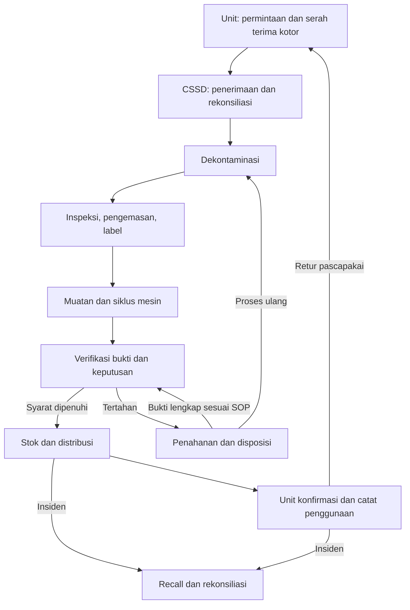

# Workflow operasional CSSD

## Notasi dan kebijakan

Tray adalah identitas fisik yang bertahan. Paket adalah hasil pengemasan dengan kode baru setiap proses ulang. Batch adalah muatan siklus. Permintaan dan manifest adalah transaksi berbeda. Pisahkan proses, mutu, lokasi, dan status insiden. Catat petugas dan waktu fisik serta waktu server. Tentukan stasiun aktif dari penugasan, dan simpan pilihan operator selama sesi.

| Tahap | Masuk dan langkah petugas | Hasil dan jalur gagal |
| --- | --- | --- |
| Permintaan | Unit isi tujuan, kebutuhan, prioritas, target; manifest retur mencantumkan tray dan kuantitas | Konfirmasi parsial atau batal sesuai status. Selisih tetap tercatat dan terlihat pada kedua sisi. |
| Penerimaan | Petugas pilih/pindai manifest/tray, cocokkan unit, isi, jumlah dan kondisi | Buat receipt dan kasus aktif. Salah unit, kode tidak dikenal, konflik kasus aktif dan selisih punya pesan terpisah. |
| Dekontaminasi | Pilih kasus yang siap, catat profil, waktu, operator dan hasil berdasarkan SOP | Lulus lanjut inspeksi; gagal buka ketidaksesuaian dan catat percobaan baru bila ditetapkan. |
| Inspeksi | Satu baris per komponen: kode/alias, harapan, aktual, fungsi dan kondisi | Tampilkan selisih di atas checklist, navigasi ke baris dan disposisi. Minta pemeriksaan ulang jika diperlukan. |
| Pengemasan | Konfirmasi checklist, jenis/lot kemasan, buat paket, cetak label dengan kode yang dapat dibaca manusia | Label fisik unik. Kegagalan print tidak mengulang pembuatan paket. Cetak ulang direkam. |
| Siklus | Pindai paket siap, pilih mesin dan profil yang kompatibel, konfirmasi isi sebelum rekam mulai | Rekam siklus selesai dan bukti. Mesin tidak layak masuk penanganan operator/supervisor. Paket yang sudah dimuat tidak masuk muatan lain secara paralel. |
| Mutu | Buka daftar Siap ditinjau, Menunggu bukti atau Ditahan. Tinjau bukti, kondisi paket, sumber, hasil, profil dan catatan koreksi | Release hanya bila gate terpenuhi menurut profil. Tahan atau tolak dengan alasan. Bukti pascalepas yang mengubah kelayakan memicu evaluasi dan blok sesuai kebijakan. |
| Stok & distribusi | Simpan ke rak, siapkan paket sesuai permintaan, pindai ulang kondisi dan tujuan sebelum kirim | Ledger pergerakan dan lokasi diperbarui atomik. Unit konfirmasi per paket dan tangani penolakan/retur. |
| Penggunaan dan retur | Unit mengonfirmasi penggunaan melalui kontrak klinis yang disetujui bila berlaku; retur membuka siklus fisik berikut | Rekam referensi terskop dan disposisi. Paket rusak atau retur dengan status tidak pasti mengikuti SOP dan tidak langsung kembali tersedia. |
| Recall | Tinjau kandidat dari batch, mesin/jendela, lot atau paket; konfirmasi scope dan distribusikan notifikasi | Blokir paket terdampak. Tindak lanjut per item: di stok, dikirim, diterima, digunakan, ditarik, belum ditemukan. Simpan CAPA dan persetujuan penutupan. |
| Downtime | Jika tersambung gagal, cek apakah request sebelumnya commit. Gunakan SOP downtime RS | Backfill dengan waktu asli, sumber, aktor dan verifier. Rekonsiliasi dengan artefak fisik dan audit. |

## Peta halaman

| Rute | Isi dan aksi utama |
| --- | --- |
| /cssd | Antrean batch sesuai gambar, scan, filter, panel ringkas. Tautkan ke pekerjaan per role. |
| /cssd/unit/requests | Permintaan, pemenuhan, retur serta konfirmasi per paket. |
| /cssd/receiving | Manifest, jumlah/kondisi aktual, penerimaan parsial. |
| /cssd/decontamination | Antrean dan detail kasus, catat proses dan hasil. |
| /cssd/packing | Pemeriksaan set, selisih, paket baru dan pencetakan. |
| /cssd/batches/[id] | Muatan, identitas mesin, evidence fisik/kimia/biologis, versi kebijakan, keputusan dan audit. |
| /cssd/quality | Antrean mutu per status dan ringkasan alasan. |
| /cssd/stock | Lokasi, reservasi, integritas kemasan, perpindahan dan disposisi. |
| /cssd/distributions | Daftar picking, serah terima, penerimaan dan retur. |
| /cssd/trace | Cari kode tray/paket/batch, jejak siklus, lokasi dan penggunaan yang berizin. |
| /cssd/recalls/[id] | Scope, notifikasi, tindak lanjut per paket dan CAPA. |
| /cssd/admin | Master, profil, perangkat, audit dan konektor sesuai kapabilitas. |
| /cssd/reports | Throughput, backlog, ketidaksesuaian, insiden, ekspor sesuai izin. |

## Fixture visual tetap

Gunakan `fixtureMode` terbatas lingkungan dev/staging. Acuan memakai 12 batch. Halaman pertama 10 baris BT-0021 sampai BT-0012. BT-0021 dipilih, Set Bedah Mayor, unit OK, 6 set, metode uap contoh, status Menunggu hasil. Baris lain mengisi status proses, verifikasi dan selesai sesuai acuan. Dua baris tambahan hanya di halaman 2. Tab dan banner menghitung data yang benar dari fixture dan definisi query. Pakai tanggal tetap 16 Januari 2025 untuk snapshot, tanpa sumber klinis. Nilai waktu indikator dan parameter produksi berasal dari profil disetujui. Uji snapshot konsisten UTC/server dan zona rumah sakit.

## Matriks izin tindakan

| Aksi | Diperbolehkan | Pembatasan |
| --- | --- | --- |
| Scan/lihat | Pengguna dengan resource scope | Jangan bocorkan keberadaan entitas di luar lingkup. |
| Proses/inspeksi | Operator stasiun | Cocokkan penugasan, fasilitas, status, profil. |
| Catat bukti | Operator atau konektor yang diberi kapabilitas | Konektor hanya input evidence, keputusan manusia mengikuti SOP. |
| Pelepasan/tahan | Reviewer dengan hak eksplisit | Verifikasi pemisahan tugas, bukti dan versi. |
| Dispatch/konfirmasi | Petugas distribusi / unit tujuan | Status inventori dan lingkup tujuan dicek lagi dalam transaksi. |
| Recall/penutupan | Peran berwenang sesuai SOP | Konfirmasi scope dan disposisi per paket. |
| Publikasi profil | Kapabilitas kebijakan | Audit versi efektif, persetujuan dan referensi SOP. |
