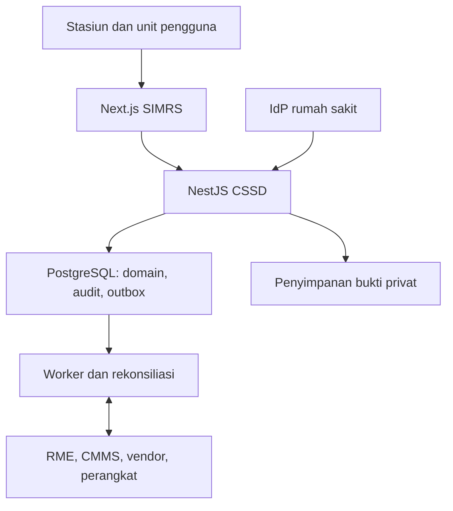

# PRD MASTER · SIMRS CSSD

**Versi 1.0 · 16 November 2026 · Baseline implementasi target produksi**

## 1. Mandat produk

Bangun modul Instalasi Sterilisasi Sentral dalam SIMRS yang menelusuri instrumen dan paket dari unit asal sampai penggunaan, retur, dan penarikan bila diperlukan. Operator mendapat antrean per stasiun, reviewer mendapat bukti dan keputusan mutu, dan unit dapat mengonfirmasi serah terima. Modul dapat dipasang dari lingkungan kosong dengan baseline konfigurasi yang terdokumentasi; pada repo pengguna, modul diintegrasikan secara aditif.

Mockup acuan adalah **Antrean Kerja biru–silver** yang dipilih pengguna, dengan banner tray dan paket biru, sidebar terang, tabel dan panel batch di kanan. Detail ukurannya ada di `DESIGN.md`. Data contoh pada gambar merupakan fixture visual. Nama personel, nama RS, angka, tanggal, status dan target contoh tidak menjadi konfigurasi produksi.

## 2. Prioritas dan batas sistem

- CSSD menguasai permintaan dan pemenuhan, katalog tray/set, penerimaan, reprocessing, bukti, keputusan, inventori, distribusi, recall dan laporan CSSD. RME menguasai identitas pasien dan episode. CMMS menguasai aset bila integrasi tersedia. Gunakan referensi, identitas eksternal stabil, dan rekonsiliasi.
- Target satu organisasi RS, beberapa fasilitas/unit bila diperlukan. Isolasi organisasi ditetapkan sebelum penyelenggaraan multi-organisasi.
- Aplikasi mendokumentasikan proses dan keputusan petugas. Mesin sterilisasi tetap bekerja menurut perangkat, SOP, IFU dan kompetensi petugas yang berlaku. Adapter mesin hanya membaca atau menerima data yang disepakati.
- Metode, vendor, tipe alat, alat pinjaman, linen, BMHP dan outsourcing didukung melalui model yang bisa dikonfigurasi. Aktifkan tiap jalur setelah RS menyetujui SOP, profil, validasi dan bukti. Tidak ada parameter klinis default lintas alat.
- Pengiriman SATUSEHAT membutuhkan use case, payload, pemilik dan pengujian yang disahkan. Hindari mengirim data CSSD melalui pemetaan klinis yang belum memiliki kontrak.

## 3. Pengguna dan kewenangan

| Persona | Tugas | Lingkup |
| --- | --- | --- |
| Petugas unit | Permintaan, manifest retur, konfirmasi paket | Unit yang ditugaskan |
| Operator penerimaan/dekontaminasi | Terima, hitung, catat selisih dan proses | Stasiun dan fasilitas yang ditugaskan |
| Operator zona bersih | Cek isi, kondisi, buat paket, cetak label | Fasilitas dan stasiun |
| Operator mesin | Atur muatan yang diizinkan, catat hasil | Mesin/fasilitas yang ditugaskan |
| Reviewer mutu | Telaah profil, bukti, tahan, tolak, setujui sesuai kebijakan | Fasilitas, kapabilitas dan kebijakan pemisahan tugas |
| Gudang/distribusi | Simpan, reservasi, picking, dispatch dan rekonsiliasi | Lokasi dan fasilitas yang ditugaskan |
| Supervisor/PPI | Tinjau insiden, ruang lingkup recall, disposisi dan CAPA | Cakupan fasilitas sesuai keputusan RS |
| Teknisi | Status mesin, perawatan dan kalibrasi | Perangkat yang ditugaskan |
| Admin/master dan auditor | Pengaturan/akses atau audit baca sesuai kapabilitas | Kapabilitas eksplisit. Admin tidak otomatis berhak melepas paket. |

Jalankan otorisasi server pada setiap permintaan, termasuk lampiran, ekspor dan file scan. Membership fasilitas/unit dan kompetensi efektif harus dapat diaudit. Detail aksi per tahap dirinci di `01-WORKFLOWS.md`.

## 4. Requirement dan keterlacakan

| ID | Hasil wajib | Uji penerimaan |
| --- | --- | --- |
| CSSD-01 | Master lokasi, jenis instrumen, alias, tray, set, resep isi versi, mesin, profil, lot dan vendor | Revisi master tidak mengubah histori. Pindai ID salah fasilitas menghasilkan respons sesuai kebijakan akses. |
| CSSD-02 | Permintaan, manifest, penerimaan parsial, selisih dan rekonsiliasi | Satu manifest dapat diterima bertahap; kuantitas dan aktor dapat ditelusuri. |
| CSSD-03 | Rekam dekontaminasi, inspeksi dan rework | Percobaan kedua tertaut ke pertama, hasil gagal tetap terlihat. |
| CSSD-04 | Checklist, lot kemasan, kode paket, label | Isi aktual tersimpan, label unik per paket, cetak ulang tidak membuat paket. |
| CSSD-05 | Rekam siklus, batch, profil, pencatatan bukti dan kondisi mesin | Hasil menyimpan sumber, aktor, waktu dan lingkup. Mesin tak layak ditangani sesuai SOP. |
| CSSD-06 | Telaah mutu, tahan/tolak/lepas dan koreksi | Bukti wajib tertunda/gagal memblokir pelepasan pada API. Koreksi pascalepas memicu evaluasi sesuai kebijakan. |
| CSSD-07 | Stok, reservasi, integritas kemasan, pemusnahan dan transfer | Dua permintaan serentak tidak bisa mengalokasikan paket yang sama. |
| CSSD-08 | Distribusi, konfirmasi per paket, retur, referensi penggunaan | Unit B tidak bisa melihat atau mengonfirmasi serah terima unit A tanpa lingkup. |
| CSSD-09 | Recall, notifikasi, penarikan parsial, disposisi dan CAPA | Satu paket di rak, satu dikirim, satu digunakan. Masing-masing memiliki tindakan dan audit. |
| CSSD-10 | Dasbor operasional, pencarian jejak, ekspor dan audit | Filter, periode, denominator, zona waktu dan izin ekspor dapat diverifikasi. |
| CSSD-11 | Perangkat, cetak, integrasi dan rekonsiliasi | Gangguan konektor tidak membuat transaksi ganda. Operator melihat status dan cara pemulihan. |
| CSSD-12 | Operasi, keamanan, observabilitas, backup, downtime dan audit pengujian | Restore dan backfill diverifikasi, termasuk lampiran dan audit. |
| CSSD-13 | Kesetiaan visual Antrean Kerja dan aksesibilitas | Cocokkan acuan 1586 × 992, uji 1440/1280, 1024 dan 390 px, keyboard, zoom, scanner dan printer. |

## 5. Arsitektur target dan keputusan

- **ADR 01, monolit modular.** Next.js App Router, NestJS, TypeScript, Prisma dan PostgreSQL mengikuti konvensi repo. Context CSSD terdiri dari katalog, proses, mutu, inventori, distribusi, recall dan reporting. Worker asinkron memisahkan gangguan integrasi dari transaksi lokal.
- **ADR 02, domain dan audit satu transaksi.** PostgreSQL sumber kebenaran status dan pergerakan. Bukti besar di penyimpanan privat dengan checksum dan relasi immutable. Publish integrasi via transactional outbox, inbox deduplikasi dan retry terbatas.
- **ADR 03, profil versi efektif.** Rekaman historis menunjuk SOP, checklist, profil, pemeriksaan wajib dan sumber bukti pada saat kejadian. Publikasi versi memerlukan kapabilitas, audit dan kriteria efektif.
- **ADR 04, referensi klinis minimal.** CSSD menyimpan rujukan tindakan sesuai kontrak, tanpa nama pasien di label, log atau antrean umum. RME memegang rincian klinis dengan akses terpisah.
- **ADR 05, identitas perangkat.** Label memuat ID manusia dan kode mesin, fokus input scanner dengan fallback manual, printer vendor melalui adapter. Upload/hasil manual menyimpan provenance; bukti eksternal tidak mengganti keputusan reviewer.

## 6. NFR dan indikator

| Area | Baseline |
| --- | --- |
| Keandalan | Usulan availability 99,9%/bulan untuk layanan inti. RPO ≤15 menit, RTO ≤2 jam. Validasi dengan RS, volume dan program downtime. |
| Kinerja | Usulan p95 pencarian scan ≤500 ms dan mutasi inti ≤1 detik pada beban yang disepakati tanpa menghitung waktu kerja fisik. Uji dengan data historis representatif. |
| Aksesibilitas | Target WCAG 2.2 AA. Uji keyboard, pembaca layar, zoom 200%, fokus, status nonwarna, kontras dan reflow. |
| Keamanan | ASVS 5.0 sebagai baseline review, kontrol akses per resource, logging tanpa identitas sensitif, pengelolaan rahasia, audit append-only, pemulihan terenkripsi. |
| Kualitas data | Audit trail, rekonsiliasi paket-unit, deteksi duplikasi, validasi provenance dan laporan dengan denominator. |
| Pengukuran produk | Median dan p90 penerimaan ke pelepasan. Proporsi set dengan selisih per jumlah set diperiksa. Proporsi paket recall yang sudah ditemukan/ditindaklanjuti per total dalam cakupan. Sajikan periode dan jumlah sampel. |

## 7. Keputusan lapangan sebelum go-live

| Blok | Hasil yang dibutuhkan | Pemilik |
| --- | --- | --- |
| G1 | Rumah sakit, cakupan fasilitas, peta stasiun, role dan kebijakan pemisahan tugas | Kepala CSSD dan TI |
| G2 | SOP dan IFU per metode, mesin, profil, indikator, penahanan, pelepasan dan recall | CSSD, PPI, teknisi |
| G3 | Scanner/printer, jenis label, VM/jaringan, autentikasi, dukungan shift | TI dan operasional |
| G4 | Kontrak eksternal, cakupan penggunaan klinis, dasar pemrosesan, retensi dan akses ekspor | RME, privasi, legal |
| G5 | Kapasitas, SLO, DR, runbook dan tanda tangan UAT/peluncuran | TI, PM, pemilik layanan |

Selesaikan build dan uji sintetis dengan profil demo. Gerbang ini menetapkan aktivasi konfigurasi nyata dan peluncuran. Detail penegakan dan bukti lihat `03-BUILD-AND-RELEASE.md`.

## 8. Rujukan

Permenkes 6/2026 tentang Rumah Sakit, Pasal 13 dan Pasal 84, termasuk pencabutan Permenkes 40/2022. Permenkes 27/2017 untuk PPI. Permenkes 24/2022 untuk rekam medis sesuai cakupan. UU 27/2022 untuk data pribadi. WHO, CDC dan NHS digunakan sebagai pembanding teknis. Syarat klinis yang diterapkan di RS mengikuti kebijakan yang disahkan, bukan parameter dalam fixture.

- [JDIH Permenkes 6/2026](https://jdih.kemkes.go.id/documents/peraturan-menteri-kesehatan-nomor-6-tahun-2026)
- [CDC · Disinfection and Sterilization, bagian 15–19](https://www.cdc.gov/infection-control/hcp/disinfection-sterilization/summary-recommendations.html)
- [WHO · Reprocessing of medical devices](https://qualityhealthservices.who.int/quality-toolkit/qt-catalog-item/decontamination-and-reprocessing-of-medical-devices-for-health-care-facilities)
- [NHS HTM 01-01 Part A, §6.17–6.19](https://www.england.nhs.uk/wp-content/uploads/2021/05/HTM0101PartA.pdf)
- [Alfred dkk. · Assembly](https://doi.org/10.1136/bmjqs-2019-010740)
- [OWASP ASVS](https://asvs.owasp.org/) dan [WCAG 2.2](https://www.w3.org/TR/WCAG22/)
