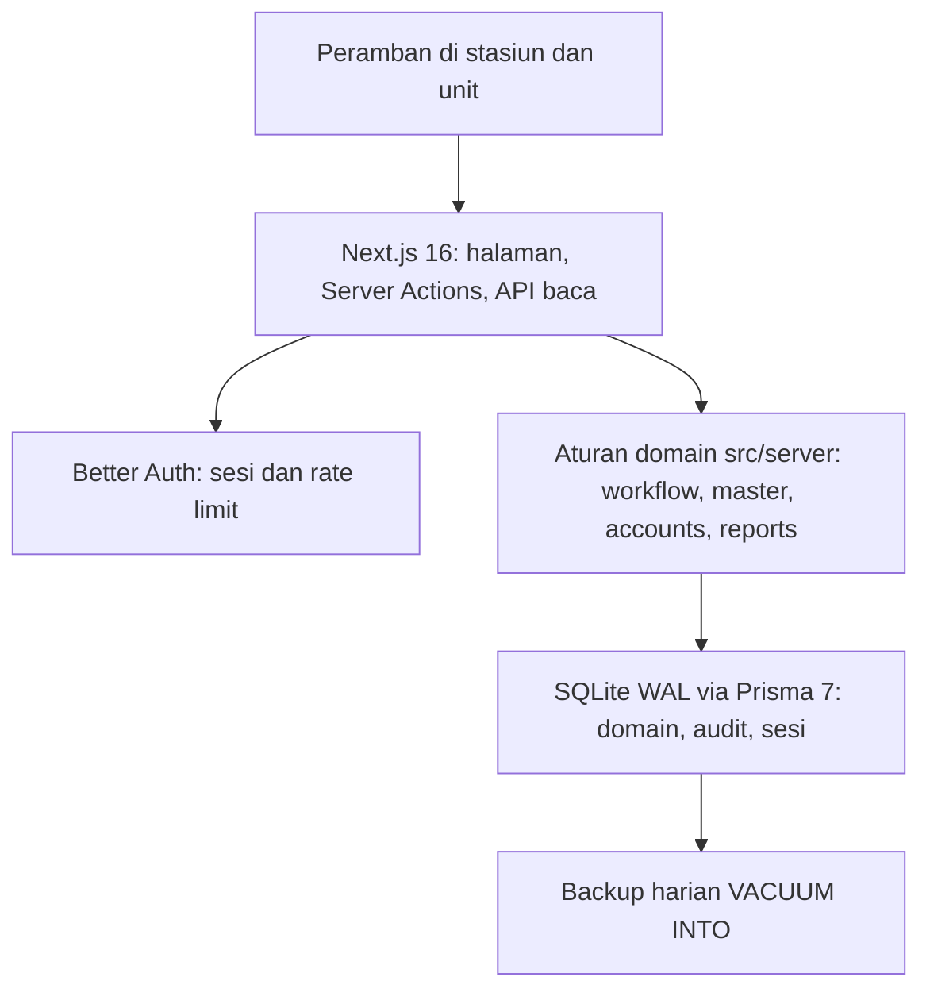

# PRD MASTER · SIMRS CSSD

**Versi 2.0 · 18 November 2026 · Satu-satunya sumber kebenaran lingkup produk**

| Versi | Tanggal | Perubahan |
| --- | --- | --- |
| 1.0 | 16 Nov 2026 | Baseline target produksi: alur, regulasi, kontrak data, arsitektur monorepo NestJS + PostgreSQL. |
| 2.0 | 18 Nov 2026 | Disesuaikan dengan aplikasi yang dibangun dan diuji: satu aplikasi Next.js + SQLite, login per petugas, semua nilai rumah sakit dikonfigurasi lewat aplikasi, status implementasi per requirement, cara kerja tim lima orang. Menggantikan PRD-PRODUCTION. |

Dokumen pendamping tetap berlaku untuk rincian: alur dan matriks izin di `01-WORKFLOWS.md`, model data dan galat di `02-DATA-API.md`, tampilan di `DESIGN.md` dan `04-ASSETS.md`. Bila ada pertentangan, dokumen ini yang berlaku.

## 1. Mandat produk

Modul Instalasi Sterilisasi Sentral (CSSD) di dalam SIMRS. Modul ini menelusuri tray dan paket dari permintaan unit, penerimaan tray kotor, dekontaminasi, inspeksi, pengemasan, siklus sterilisasi dan keputusan mutu, sampai stok, distribusi, penggunaan, retur, dan penarikan (recall) bila diperlukan.

Pembagian peran:
- Operator mendapat antrean per stasiun.
- Reviewer mendapat bukti dan keputusan mutu.
- Unit pengguna meminta set dan mengonfirmasi serah terima per paket.
- Supervisor dan auditor mendapat jejak lengkap, laporan, dan ekspor.

Aplikasi mendokumentasikan proses dan keputusan petugas. Mesin sterilisasi tetap bekerja menurut perangkatnya, SOP, IFU, dan kompetensi petugas. Aplikasi tidak menggantikan keputusan klinis.

## 2. Prinsip produksi

1. **Tanpa data contoh di produksi.** Database baru kosong, dan pemasangan pertama membuka wizard yang membuat fasilitas serta admin pertama. Data latihan hanya dimuat dengan perintah terpisah ke database kosong, dan selalu berlabel "Data latihan".
2. **Tanpa peran demo.** Semua akses melalui akun personal dengan peran dari admin, dan setiap tindakan tercatat atas nama orangnya.
3. **Semua nilai khusus rumah sakit dikonfigurasi lewat aplikasi.** Ini mencakup nama fasilitas, unit, rak, mesin, isi set, masa simpan, indikator wajib per metode, dan akun. Tidak ada parameter klinis yang ditanam di kode. Operasi yang butuh konfigurasi menolak dengan pesan yang menyebut apa yang harus diisi.
4. **Aturan ditegakkan di server**, di dalam transaksi, dengan jejak audit pada transaksi yang sama. Layar hanya mencerminkan aturan itu.
5. **Bisa dipulihkan.** Backup harian otomatis, backup sesuai permintaan, dan prosedur restore tertulis.
6. **Tidak memalsukan integrasi.** Integrasi dengan pihak luar (RME, CMMS, mesin, IdP, SATUSEHAT) dibangun hanya setelah ada kontrak. Sebelum itu, petugas mencatat manual.

## 3. Arsitektur dan keputusan (ADR)

| ADR | Keputusan | Alasan dan dampak |
| --- | --- | --- |
| 01 | Satu aplikasi Next.js App Router (menggantikan monorepo NestJS v1.0) | Satu proses untuk dipasang dan dirawat TI rumah sakit. Aturan bisnis terpisah di `src/server`, sehingga bisa dipindah ke layanan terpisah bila kelak dibutuhkan. |
| 02 | SQLite mode WAL lewat Prisma 7 (menggantikan PostgreSQL v1.0) | Tanpa server database terpisah; cukup untuk satu fasilitas dengan puluhan stasiun. Jalur migrasi ke PostgreSQL: ganti provider dan adapter, buat migrasi baru (lihat bagian 10). |
| 03 | Better Auth, login username + kata sandi, sesi di database | Hash scrypt, cookie httpOnly/sameSite, rate limit login. SSO/IdP rumah sakit ditambahkan setelah kontrak tersedia. |
| 04 | Konkurensi optimistis: kolom `version` + `updateMany` bersyarat di dalam transaksi | Menggantikan `Idempotency-Key` v1.0. Kirim ganda dan aksi bersamaan menghasilkan satu pemenang; yang kalah mendapat pesan konflik. Diuji di T04. |
| 05 | Kebijakan bukti per metode dengan rujukan SOP; batch menyimpan rujukan saat siklus selesai | Perubahan kebijakan tidak mengubah riwayat batch lama. |
| 06 | Audit append-only di tabel `AuditEvent`, ditulis dalam transaksi yang sama dengan perubahan | Aplikasi tidak pernah mengubah atau menghapus baris audit. |

## 4. Peran dan kewenangan

Admin menetapkan satu peran per akun. Petugas unit juga diikat ke satu unit. Otorisasi diperiksa di server untuk setiap aksi dan setiap unduhan.

| Peran | Kapabilitas |
| --- | --- |
| Petugas Unit | Meminta set untuk unitnya, menerima atau menolak paket, mencatat penggunaan |
| Operator Penerimaan | Menerima tray, mencatat dekontaminasi |
| Operator Pengemasan | Inspeksi per komponen, membuat paket, mencetak label |
| Operator Mesin | Menyusun muatan, menjalankan siklus, mencatat bukti |
| Reviewer Mutu | Mencatat bukti, melepas, menahan, menolak (tidak untuk batch yang ia jalankan sendiri) |
| Petugas Distribusi | Memenuhi permintaan, mengirim paket, menempatkan dan memindah rak, menarik paket kedaluwarsa |
| Supervisor CSSD | Recall dan CAPA, laporan, audit, baca semua |
| Auditor | Baca semua, laporan, audit, ekspor; tanpa tindakan |
| Admin CSSD | Fasilitas, master, kebijakan, akun, backup. **Tidak** memproses atau melepas paket. |

## 5. Requirement produksi dan status

Status: **Selesai** berarti dibangun dan dibuktikan oleh tes otomatis yang disebut. Kolom tes merujuk ke `tests/integration` (I) dan `tests/e2e` (E).

| ID | Fungsi | Uji penerimaan | Status | Bukti tes |
| --- | --- | --- | --- | --- |
| P-01 | Wizard pemasangan pertama | Database kosong membuka wizard; setelah fasilitas dan admin dibuat, wizard tertutup permanen | Selesai | E: wizard tertutup setelah dipasang |
| P-02 | Login, logout, ganti sandi, sesi 12 jam | Percobaan salah dibatasi; akun nonaktif tidak bisa masuk; sesi dicabut saat akun dinonaktifkan | Selesai | I: akun pengguna; E: login dan arahan kembali |
| P-03 | Kelola pengguna | Admin membuat akun dengan sandi awal; wajib ganti saat masuk pertama; nonaktifkan dan atur ulang sandi; admin aktif terakhir dilindungi | Selesai | I: akun pengguna; E: admin membuat akun |
| P-04 | Master: unit, rak, mesin, set dan komponen, tray | Kode unik per fasilitas; perubahan diaudit; item terpakai dinonaktifkan, bukan dihapus | Selesai | I: master; E: set, komponen, tray |
| P-05 | Kebijakan bukti per metode dan masa simpan | Indikator wajib per metode; tanpa kebijakan siklus tidak bisa selesai; indikator tak wajib tidak menahan pelepasan | Selesai | I: T03 dan P-05 |
| P-06 | Permintaan unit | Unit meminta set; distribusi memenuhi sebagian atau penuh; status terbuka/sebagian/terpenuhi/batal; lingkup unit dijaga | Selesai | I: P-06; E: permintaan dipenuhi dari stok |
| P-07 | Penerimaan dan dekontaminasi | Satu proses aktif per tray; selisih wajib catatan; percobaan gagal tetap tercatat | Selesai | I: T05 |
| P-08 | Inspeksi per komponen | Satu baris per komponen; kurang/rusak/hilang wajib catatan dan mengembalikan tray ke proses ulang | Selesai | I: T05; E: inspeksi per komponen |
| P-09 | Paket, label, kedaluwarsa | Label Code 128; cetak ulang tercatat tanpa membuat paket baru; kedaluwarsa dihitung saat dilepas | Selesai | I: T05, P-09 |
| P-10 | Muatan, siklus, bukti, keputusan mutu | Gerbang pelepasan memakai kebijakan; pemisahan tugas; hasil gagal setelah lepas menahan batch | Selesai | I: T03, T04 |
| P-11 | Stok steril | Paket per rak; pindah rak; paket kedaluwarsa keluar dari ketersediaan dan bisa ditarik | Selesai | I: P-09 dan P-11 |
| P-12 | Distribusi dan penggunaan | Kirim dengan atau tanpa permintaan; konfirmasi per paket; paket kedaluwarsa, ditahan atau diblokir tidak bisa dikirim | Selesai | I: T02, T06; E: alur lintas peran |
| P-13 | Recall dan CAPA | Semua paket batch diblokir seketika; tindak lanjut per paket; penutupan wajib CAPA | Selesai | I: T07; E: supervisor menutup recall |
| P-14 | Pelacakan | Cari kode paket/tray/batch/kasus; riwayat lengkap dengan nama pelaku | Selesai | E: supervisor menelusuri |
| P-15 | Laporan | Periode zona fasilitas; volume, waktu putar median dan p90, rasio gagal dengan pembilang/penyebut; ekspor CSV tercatat di audit | Selesai | I: laporan dan ekspor; E: laporan |
| P-16 | Audit | Filter kode, pelaku, periode; ekspor CSV aman dari formula injection | Selesai | I: ekspor audit; E: audit |
| P-17 | Backup dan pemulihan | Backup harian otomatis (simpan 14 hari), unduhan admin tercatat, prosedur restore tertulis | Selesai; uji restore oleh TI RS belum | E: admin membuat dan mengunduh backup |
| P-18 | Pencatatan mundur saat downtime | Waktu kejadian lampau maksimal 72 jam dengan alasan; waktu pencatatan server tersimpan terpisah | Selesai | I: P-18 |

## 6. Keterlacakan ke requirement v1.0

| v1.0 | Cakupan | Dipenuhi oleh | Sisa pekerjaan |
| --- | --- | --- | --- |
| CSSD-01 Master | Lokasi, set, komponen, mesin, kebijakan | P-04, P-05 | Versi resep set yang eksplisit; saat ini inspeksi menyimpan salinan nama dan jumlah komponen |
| CSSD-02 Permintaan, manifest | Permintaan, penerimaan, selisih | P-06, P-07 | Manifest retur multi-tray dari unit |
| CSSD-03 Dekontaminasi, rework | Percobaan tertaut, gagal tetap terlihat | P-07, P-08 | Selesai |
| CSSD-04 Checklist, label | Isi aktual per komponen, label unik, cetak ulang | P-08, P-09 | Selesai |
| CSSD-05 Siklus dan bukti | Sumber, aktor, waktu, lingkup | P-10, P-18 | Lampiran berkas bukti (cetakan mesin, foto BI) |
| CSSD-06 Telaah mutu | Gerbang di server, tahan/tolak/lepas | P-10 | Selesai |
| CSSD-07 Stok | Ketersediaan, kedaluwarsa, satu pemenang | P-11, P-12 | Reservasi paket untuk permintaan sebelum dikirim |
| CSSD-08 Distribusi | Konfirmasi per paket, lingkup unit | P-12 | Referensi klinis penggunaan (butuh kontrak RME) |
| CSSD-09 Recall | Blok, tindak lanjut per item, CAPA | P-13 | Notifikasi otomatis ke unit |
| CSSD-10 Laporan dan audit | Periode, denominator, zona, izin ekspor | P-14, P-15, P-16 | Dasbor tren grafik |
| CSSD-11 Perangkat dan integrasi | Cetak, scanner, konektor | P-09 (cetak lewat peramban, scanner sebagai keyboard) | Adapter printer label, impor mesin, outbox integrasi |
| CSSD-12 Operasi | Backup, downtime, audit | P-17, P-18 | Observabilitas (metrik, alarm) dan uji restore terjadwal |
| CSSD-13 Visual dan aksesibilitas | Acuan 1586x992, reflow, keyboard | Semua layar | Selesai; diuji axe WCAG 2.2 AA dan reflow 1440/1280/1024/390 |

## 7. NFR

| Area | Target | Status |
| --- | --- | --- |
| Keamanan | Hash sandi, cookie httpOnly/sameSite, rate limit login, otorisasi per aksi di server, header keamanan, galat generik, audit append-only, `pnpm audit --prod` bersih sebelum rilis | Terpenuhi pada rilis ini |
| Aksesibilitas | WCAG 2.2 AA, keyboard, fokus terlihat, status tidak hanya warna, reflow 390 px, target sentuh 44 px | Diuji otomatis; uji pembaca layar manual oleh tim |
| Kinerja | Halaman kerja < 1 detik pada data 2 tahun satu fasilitas | Indeks per status dan waktu tersedia; uji beban oleh tim sebelum go-live |
| Data | Waktu disimpan UTC dan ditampilkan dalam zona fasilitas; tanpa identitas pasien di label, log atau antrean | Terpenuhi |
| Keandalan | Backup harian; RPO ≤ 24 jam dengan backup bawaan, lebih ketat dengan backup terjadwal TI | Terpenuhi; target RPO/RTO final ditetapkan RS |

## 8. Gerbang go-live

Aplikasi menyediakan alatnya; keputusannya milik rumah sakit. Status ini **tidak boleh** dianggap lulus hanya karena tes otomatis lulus.

| Blok | Yang harus diputuskan dan dimasukkan rumah sakit | Tempat di aplikasi | Pemilik |
| --- | --- | --- | --- |
| G1 | Fasilitas, unit, peran dan akun petugas | Wizard, Master: Unit dan Pengguna | Kepala CSSD dan TI |
| G2 | SOP/IFU per metode: indikator wajib, masa simpan per set, isi set | Master: Kebijakan, Set | CSSD, PPI |
| G3 | Server, jaringan, HTTPS, scanner dan printer label diuji pada label nyata | README bagian Pemasangan | TI |
| G4 | Retensi data, akses ekspor, kebutuhan integrasi RME | Peran Auditor, ekspor | RME, privasi, legal |
| G5 | UAT per peran, uji restore backup, pelatihan, tanda tangan peluncuran | Data latihan, halaman Backup | Pemilik layanan |

## 9. Cara kerja tim

Dikerjakan lima orang lewat GitHub dengan aturan di `CONTRIBUTING.md`. Ringkasnya:

- `main` dilindungi. Semua perubahan lewat pull request yang lulus CI dan disetujui minimal satu anggota lain.
- Setiap anggota commit dari akun GitHub-nya sendiri, dengan email yang terhubung ke akun itu, sehingga log tercatat per username.
- Format kode, lint, typecheck, tes integrasi, build dan E2E dijalankan otomatis di setiap PR; pesan commit mengikuti Conventional Commits.
- Pembagian area kepemilikan:

| Area | Lingkup kode |
| --- | --- |
| A. Platform dan keamanan | `src/server/auth.ts`, `identity.ts`, `accounts.ts`, `backup.ts`, `src/proxy.ts`, CI |
| B. Data dan alur domain | `prisma/`, `src/server/workflow.ts`, `master.ts`, `queue/` |
| C. Layar operasional | `src/app/cssd/` (antrean, penerimaan, batch, stok, distribusi, permintaan) |
| D. Supervisi dan admin | `src/app/cssd/admin`, `reports`, `audit`, `trace`, `recalls`, `src/server/reports.ts` |
| E. Mutu, tes dan dokumen | `tests/`, `CSSD-Master/`, `README.md`, `DESIGN.md` |

## 10. Rencana lanjutan

Urutan yang disarankan setelah v2.0:

1. Lampiran bukti siklus (cetakan mesin, foto BI) dengan checksum.
2. Reservasi paket untuk permintaan sebelum dikirim, dan manifest retur multi-tray.
3. Migrasi ke PostgreSQL bila lebih dari satu server atau volume besar: ganti `provider` di `prisma/schema.prisma` dan adapter di `src/server/db.ts`, buat migrasi baru, jalankan ulang seluruh tes.
4. SSO/IdP rumah sakit sebagai metode masuk tambahan di Better Auth.
5. Adapter printer label dan impor data mesin, setelah ada spesifikasi vendor.
6. Integrasi RME dan SATUSEHAT setelah kontrak dan use case disahkan.

## 11. Rujukan

Permenkes 6/2026 tentang Rumah Sakit (Pasal 13 dan 84, termasuk pencabutan Permenkes 40/2022). Permenkes 27/2017 tentang PPI. Permenkes 24/2022 tentang rekam medis. UU 27/2022 tentang Pelindungan Data Pribadi. WHO, CDC dan NHS sebagai pembanding teknis. Syarat klinis yang berlaku di rumah sakit mengikuti kebijakan yang disahkan, bukan nilai bawaan aplikasi.

- [JDIH Permenkes 6/2026](https://jdih.kemkes.go.id/documents/peraturan-menteri-kesehatan-nomor-6-tahun-2026)
- [CDC · Disinfection and Sterilization, bagian 15–19](https://www.cdc.gov/infection-control/hcp/disinfection-sterilization/summary-recommendations.html)
- [WHO · Reprocessing of medical devices](https://qualityhealthservices.who.int/quality-toolkit/qt-catalog-item/decontamination-and-reprocessing-of-medical-devices-for-health-care-facilities)
- [NHS HTM 01-01 Part A, §6.17–6.19](https://www.england.nhs.uk/wp-content/uploads/2021/05/HTM0101PartA.pdf)
- [Alfred dkk. · Assembly](https://doi.org/10.1136/bmjqs-2019-010740)
- [OWASP ASVS](https://asvs.owasp.org/) dan [WCAG 2.2](https://www.w3.org/TR/WCAG22/)
