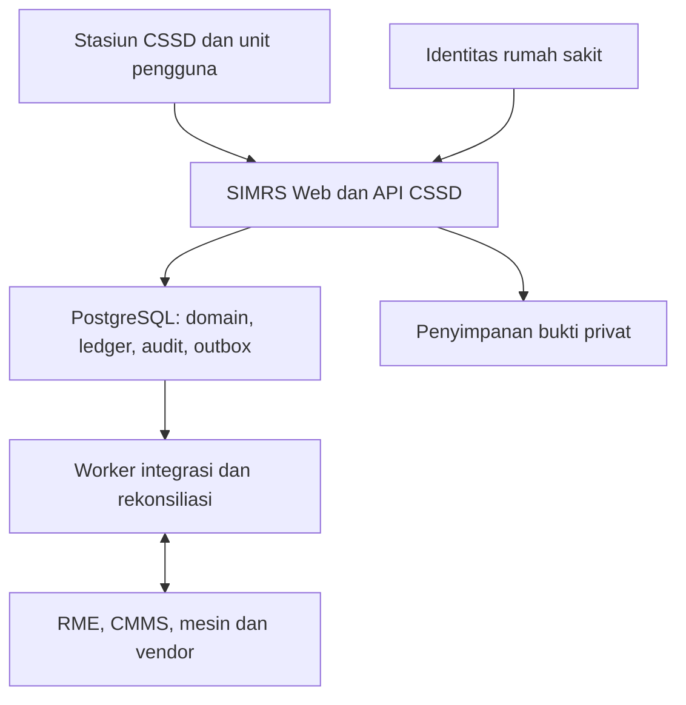

# Spesifikasi Target Produksi SIMRS CSSD
16 November 2026 · Baseline rancangan untuk implementasi dan validasi di rumah sakit

Dokumen ini menggantikan baseline prototipe UAS untuk keputusan proyek berikutnya. Lingkup produksi mencakup operasi harian, pengecualian, penelusuran, pengendalian mutu, keamanan, dan pemulihan layanan. Rumah sakit target, SOP/IFU, jumlah stasiun, vendor mesin, kapasitas, SLO dan dasar retensi lokal masih harus ditetapkan. Status saat ini: spesifikasi target; implementasi, verifikasi dan persetujuan go-live belum dilakukan.

## 1. Dasar riset dan kedudukan sumber

| Rujukan | Konsekuensi desain dan verifikasi |
| --- | --- |
| [Permenkes 6/2026 tentang Rumah Sakit](https://jdih.kemkes.go.id/storage/documents/pdfs/2026permenkes006.pdf), Pasal 13 dan 84 | Mencakup pelayanan sterilisasi sentral dan memungkinkan kerja sama pihak ketiga pada layanan yang disebut. Pasal 84 huruf t mencabut Permenkes 40/2022. Ketentuan teknis dan perizinan yang berlaku untuk kelas dan lokasi RS dipetakan bersama penanggung jawab RS. Pembagian kerja kotor/bersih/steril dipakai sebagai rancangan operasional sesuai SOP. |
| [Permenkes 27/2017 tentang PPI](https://jdih.kemkes.go.id/documents/peraturan-menteri-kesehatan-nomor-27-tahun-2017) | PPI dilibatkan dalam verifikasi proses, insiden, dan tindak lanjut. |
| [WHO reprocessing](https://qualityhealthservices.who.int/quality-toolkit/qt-catalog-item/decontamination-and-reprocessing-of-medical-devices-for-health-care-facilities), [FDA reprocessing](https://www.fda.gov/medical-devices/reprocessing-reusable-medical-devices/how-are-reusable-medical-devices-reprocessed) | Pembersihan, inspeksi, pengemasan, pemrosesan, penyimpanan dan transportasi menjadi tahap terpisah. Profil mengikuti IFU alat, mesin, dan kemasan yang disahkan RS. |
| [CDC, bagian 15–19](https://www.cdc.gov/infection-control/hcp/disinfection-sterilization/summary-recommendations.html), [ISO 17665:2024](https://www.iso.org/standard/80271.html) | Rekam isi muatan, parameter, bukti pemantauan dan operator. Kebijakan pelepasan dan cakupan insiden bergantung pada metode, kondisi dan SOP. Entri katalog ISO menunjukkan ruang lingkup panas lembap. Penilaian kepatuhan memerlukan standar lengkap dan bukti validasi. |
| [NHS HTM 01-01 Part A, §6.17–6.19](https://www.england.nhs.uk/wp-content/uploads/2021/05/HTM0101PartA.pdf), [Alfred dkk.](https://doi.org/10.1136/bmjqs-2019-010740), [tinjauan proses SPD](https://pmc.ncbi.nlm.nih.gov/articles/PMC13460267/) | Hubungkan siklus, set, operator dan penggunaan. Gunakan checklist dengan nama komponen baku, alias dan selisih. Studi membantu prioritas fitur, sementara SOP dan pengukuran lokal menentukan target. |
| [UU 27/2022 PDP](https://peraturan.bpk.go.id/Home/Download/224884/UU%20Nomor%2027%20Tahun%202022.pdf), [Permenkes 24/2022 RME](https://jdih.kemkes.go.id/documents/peraturan-menteri-kesehatan-nomor-24-tahun-2022) | Data kesehatan adalah data pribadi spesifik. Pisahkan identitas klinis dari meja kerja CSSD, batasi akses dan ekspor, dan petakan retensi per jenis rekaman dengan tim hukum/RME. |
| [SATUSEHAT Interoperabilitas](https://satusehat.kemkes.go.id/platform/docs/id/interoperability/), [OWASP ASVS](https://asvs.owasp.org/), [WCAG 2.2](https://www.w3.org/TR/WCAG/) | Integrasi eksternal memakai use case resmi. Verifikasi keamanan dengan daftar kontrol ASVS versi yang dikunci dan aksesibilitas dengan target WCAG 2.2 AA. |

WHO/CDC/NHS/FDA dipakai sebagai rujukan teknis pembanding. Catat setiap aturan operasional dalam register yang memuat sumber, pasal/bagian atau dokumen SOP/IFU, versi, pemilik, persetujuan, tanggal efektif, dan skenario verifikasi.

## 2. Fitur produksi dan kriteria penerimaan

| ID | Kapabilitas | Bukti penerimaan |
| --- | --- | --- |
| F01 | Master per fasilitas/unit/zona, katalog instrumen dan alias, tray, komposisi versi, mesin/program, rak, lot dan pemasok | Perubahan master menciptakan versi baru. Riwayat menampilkan data sesuai transaksi asal. Skema identitas bisa mendukung set dan serial item sesuai keputusan lokal. |
| F02 | Permintaan terjadwal/mendesak, pengambilan, pengiriman lot kotor, penerimaan parsial, selisih, penolakan dan pengembalian | Selisih kuantitas terpantau hingga terselesaikan dan kedua sisi serah terima tercatat. |
| F03 | Dekontaminasi manual atau mesin yang disahkan, antrean, siklus pembersihan, inspeksi, pengerjaan ulang dan segregasi | Pekerjaan gagal diblokir pada tahap berikutnya; proses ulang memiliki hubungan dengan pekerjaan asal. |
| F04 | Perakitan, kondisi/fungsi alat, komponen kurang/salah/rusak, kemasan dan lot, label/scan, cetak ulang atau pembatalan label | Label menunjuk tepat satu paket; cetak ulang menggunakan identitas sama dan tercatat. Label batal ditolak saat dipindai. |
| F05 | Pemuatan, batch, metode, mesin, program, hasil manual atau impor, pemeriksaan berkala, kalibrasi dan perawatan | Hasil menyimpan sumber, cakupan, waktu, unit ukur dan versi profil. Mesin tak layak tidak dapat dipilih untuk proses rutin; kasus siklus berjalan diperiksa supervisor. |
| F06 | Telaah mutu, tahan, gagal, lepas, pemeriksaan per paket, koreksi dan evaluasi ulang | API menolak pelepasan jika bukti wajib belum valid atau gagal. Koreksi setelah lepas memicu evaluasi dan mengunci distribusi bila syarat lepas tidak lagi terpenuhi. |
| F07 | Lokasi dan stok steril, integritas kemasan, kebijakan masa simpan, reservasi, picking, transfer, retur dan pemusnahan | Paket yang tidak lagi layak atau tertahan hilang dari stok tersedia. Tidak terjadi distribusi ganda pada dua stasiun. |
| F08 | Dispatch, penerimaan per paket, penolakan, retur dari unit, dan pencatatan penggunaan melalui integrasi RS bila diperlukan | Status dipilah per paket. Penggunaan tertaut ke referensi klinis terbatas jika kebijakan dan kontrak RS mewajibkan. |
| F09 | Penelusuran maju/mundur, karantina, recall, notifikasi dan konfirmasi, eskalasi, CAPA dan bukti penutupan | Paket yang tersedia dan dikirim ditemukan. Paket sudah dipakai atau tidak ditemukan memiliki hasil dan eskalasi tersendiri. Supervisor/PPI menutup setelah rekonsiliasi sesuai SOP. |
| F10 | Laporan proses, mutu, stok, utilisasi, waktu putar, recall, ekspor berizin, review dan audit | Laporan memiliki denominator, periode, zona waktu dan definisi; dataset cocok dengan ledger dan hak akses. |
| F11 | Integrasi RME/OK, aset/CMMS, perangkat, printer/scanner dan pihak ketiga bila digunakan | Kontrak/versioning, identitas eksternal, deduplikasi, rekonsiliasi, isolasi kegagalan dan pemilik tiap integrasi diuji. Outsourcing memiliki bukti siklus vendor dan serah terima. |
| F12 | Tata kelola, pelatihan, kelangsungan operasional dan rekonsiliasi downtime | Simulasi layanan putus, pencatatan sesuai SOP, pemulihan, dan input ulang terverifikasi tanpa menggandakan kejadian. |

Target metode dan jenis alat ditetapkan per RS. Buat matriks kemampuan per fasilitas untuk uap, suhu rendah, pemrosesan jalur khusus, linen/BMHP, alat pinjaman dan vendor. Jalur khusus atau perangkat yang memerlukan alur tersendiri diaktifkan setelah SOP, peralatan, dan validasinya tersedia.

## 3. Alur layanan dan aturan keputusan

1. Unit meminta set atau mengembalikan alat. Catat unit, urgensi, serah terima, manifest dan waktu. Petugas CSSD merekonsiliasi isi dan mulai kasus pemrosesan.
2. Petugas mendokumentasikan dekontaminasi dan inspeksi sesuai versi SOP. Selisih, kerusakan atau hasil gagal membuka ketidaksesuaian. Rework mencatat percobaan baru.
3. Petugas mengemas alat yang lolos, merekam checklist dan lot, membuat ID paket, lalu memilih batch dengan profil yang diizinkan.
4. Mesin selesai menghasilkan peristiwa siklus selesai. Rekam bukti fisik, kimia dan biologis sesuai cakupan aturan, termasuk waktu pengambilan dan validasi. Profil efektif dipertahankan untuk histori.
5. Petugas mutu meninjau bukti dan kondisi paket. Keputusan mencatat aktor, waktu, alasan dan versi bukti. Distribusi hanya tersedia bila keputusan sah, kondisi sesuai, dan paket bebas dari blok aktif.
6. Unit menerima atau menolak per paket. Rekam penggunaan bila berlaku, retur, atau status akhir lainnya. Retur pascapenggunaan membuka kasus pemrosesan baru.
7. Saat ada insiden, tampilkan kandidat berdasarkan batch, mesin/jendela siklus, lot, atau paket. Petugas berwenang menetapkan ruang lingkup. Inventori terdampak diblokir secara transaksional. Dashboard recall memantau stok, perjalanan, penerimaan, penggunaan, penarikan, dan eskalasi.

| Dimensi | Status utama |
| --- | --- |
| Proses | Diterima, dekontaminasi, inspeksi, dikemas, dimuat, siklus selesai, batal |
| Mutu | Menunggu, tahan, ditolak, dilepas, dalam peninjauan ulang |
| Pergerakan | Di CSSD, tersedia, dipesan, dikirim, diterima, digunakan, dikembalikan, dimusnahkan |
| Insiden per item | Teridentifikasi, diblokir/diberitahu, dikonfirmasi, berhasil ditarik, sudah digunakan, belum ditemukan, selesai sesuai disposisi |

Gate mutu menghitung syarat berdasarkan profil yang disahkan, kondisi terkini, dan bukti yang melekat. Gagal final diikuti disposisi/reprocess. Bukti tertunda dapat dilengkapi lalu diajukan lagi. Hasil biologis terlambat setelah pelepasan memicu penilaian insiden sesuai kebijakan, tanpa hardcode satu keputusan recall untuk semua metode. Kebijakan lokal menetapkan pemisahan operator dan verifier, penanganan implan, pelepasan dalam keadaan khusus, retensi, dan eskalasi. Workflow khusus hanya aktif jika kebijakan disahkan dan memiliki jejak keputusan.

## 4. Arsitektur dan integrasi dengan repo

**ADR-01** Pertahankan monolit modular NestJS/Next.js/Prisma pada baseline repo. Pisahkan bounded context katalog, proses, mutu, inventori, distribusi, insiden, dan pelaporan dalam modul. Pekerja asinkron menangani adapter dan notifikasi. Layanan mandiri baru dipertimbangkan jika isolasi atau kapasitas terukur memerlukannya.

**ADR-02** PostgreSQL adalah sumber transaksi. Bukti besar masuk penyimpanan privat dengan checksum, status verifikasi dan metadata DB. Sumber eksternal masuk melalui adapter read-only untuk mesin dan konektor RME/CMMS dengan kontrak yang diuji. Gunakan outbox/inbox, retry terbatas, dead-letter, dan rekonsiliasi. Pemrosesan lokal tetap tersedia saat konektor terganggu sesuai mode penurunan layanan. Worker SATUSEHAT hanya menerima pemetaan use case yang disahkan.

**ADR-03** Saat lepas, tahan, dispatch atau recall, evaluasi ulang paket dan blok aktif dalam satu transaksi. Gunakan penguncian atau update bersyarat, constraint unik dan urutan lock konsisten. Audit dan outbox ikut commit. Permintaan ulang dengan kunci dan payload sama mengembalikan hasil sebelumnya. Kunci sama dengan payload berbeda menghasilkan konflik. Worker dan penerima event deduplikasi berdasarkan ID stabil.

**ADR-04** Tenant awal berupa satu organisasi RS dengan pembatasan fasilitas dan unit. Tentukan isolasi antarorganisasi sebelum hosting bersama. Integrasikan IdP RS, akun personal dan MFA untuk akses istimewa sesuai kebijakan RS. Identitas klinis tetap dikuasai RME. CSSD menyimpan ID rujukan tindakan yang dibatasi, dengan akses rincian klinis melalui otorisasi yang disahkan.

**Dampak repo** Tambahkan route web CSSD dan portal unit, modul API CSSD, migration Prisma aditif, dan feature flag per fasilitas. Evaluasi perubahan role guard, navigation, logout/session, audit dan skema error lintas aplikasi. Audit yang ada dapat ikut transaksi; produksi memerlukan proteksi terhadap perubahan, cakupan audit konfigurasi/ekspor dan pemantauan akses. Perbarui PRD prototipe dan kontrak konsumen melalui review perubahan proyek. Lakukan baseline lint, typecheck, build dan regresi sebelum merge.

## 5. Model data dan kontrak API

| Agregat | Data utama dan batas integritas |
| --- | --- |
| Katalog dan perangkat | Unit/Zone/Rack, InstrumentType/Alias, Tray, SetTemplateVersion/Component, Device/ProgramVersion, Maintenance, PolicyVersion, Competency, Vendor. Referensi versi efektif disimpan pada transaksi. |
| Pemrosesan dan bukti | Receipt, Case, CleaningRun, Inspection, Pack/PackItemSnapshot, Load/LoadPack, MonitorResult, ReleaseDecision, Attachment. ID tray bertahan; ID paket baru per pengemasan ulang; muatan historis dapat ditelusuri. Hasil dapat dicatat di lingkup mesin, siklus atau paket. |
| Logistik dan penggunaan | StockMovement, Reservation, Handover/Line, UsageReference. Pergerakan ditulis atomik dengan perubahan stok dan event. Referensi klinis bisa ditelusuri hanya oleh peran sah. |
| Pengecualian | Nonconformity, Hold, Incident, Recall/Item, Notification/Acknowledgement, CAPA, Disposition, Correction. Satu paket dapat memiliki beberapa blok aktif; penyelesaian satu blok tidak membebaskan blok lain. |
| Infrastruktur | AuditEvent, Outbox/Inbox, IdempotencyRecord, ImportJob. UTC pada penyimpanan, tampilkan zona RS, simpan waktu kejadian dan waktu pencatatan. Indeks minimal untuk kode, mesin+waktu, batch, unit+status, korelasi klinis dan insiden. |

**Kontrak awal** `POST /api/v1/cssd/receipts`, `POST /cases/{id}/cleaning-runs`, `POST /cases/{id}/packs`, `POST /loads`, `POST /loads/{id}/monitor-results`, `POST /loads/{id}/release-decisions`, `POST /handovers`, `POST /handovers/{id}/acknowledgements`, `POST /incidents/{id}/recalls`, `GET /trace?code=...`. Rute relatif memakai prefix yang sama. Gunakan OpenAPI, validasi server, paginasi, filter, korelasi, dan respons galat baku. Aksi kritis membawa idempotency key dan versi entitas yang diamati. Status 409 dipakai untuk konflik versi/status dan 422 untuk bukti domain tidak memadai sesuai kontrak final. Jangan memberikan detail entitas dari unit di luar hak pengguna.

**Profil mutu** ID dan versi, mesin/program/metode, rujukan SOP/IFU, efektivitas, kelas muatan, daftar pemeriksaan dan tingkatnya, evaluasi, kewenangan, kondisi pengecualian dan retensi. Publikasi versi memiliki audit. Perubahan nilai setelah keputusan membuat catatan pengganti, dengan rujukan hasil sebelumnya dan alasan. Verifikasi dokumen, checksum dan aturan penyimpanan bukti dalam uji restore.

## 6. Desain sistem antarmuka

| Stasiun | Layar utama | Informasi dan tindakan |
| --- | --- | --- |
| Unit pelayanan | Permintaan, retur, penerimaan dan notifikasi recall | Unit dan prioritas, manifest, jumlah dikirim/diterima, konfirmasi per paket |
| Penerimaan dan zona kotor | Antrean, scanner, form serah terima, dekontaminasi | Kode tray, unit asal, kondisi, selisih, alat dan status proses |
| Zona bersih | Checklist perakitan, pengemasan, label | Foto referensi bila bermanfaat, kode/alias, jumlah harapan/aktual, alasan gagal, cetak/pratinjau |
| Mesin dan mutu | Detail mesin, batch, bukti, keputusan | Isi muatan, versi profil, status tiap bukti, kondisi, alasan aksi diblokir, histori keputusan |
| Stok dan distribusi | Lokasi, picking, packing, dispatch | Stok tersedia/ditahan, unit tujuan, kode paket, kondisi dan distribusi parsial |
| Supervisor dan PPI | Pelacakan, recall, CAPA, laporan | Grafik jejak yang dapat dibuka sebagai tabel, daftar kandidat, lokasi terakhir, tindakan dan pengakuan unit |
| Admin dan teknisi | Master, versi kebijakan, perangkat, integrasi, audit | Otorisasi konfigurasi, pemeliharaan, kesehatan konektor, antrian rekonsiliasi |

Pertahankan shell SIMRS dan komponen datanya. Gunakan token warna semantik ditambah label/ikon, indikator fokus jelas, target sentuh sesuai stasiun, dan navigasi keyboard. Scanner bertindak sebagai input dengan fallback manual. Status hasil baca, salah identitas, label rusak, kegagalan print, koneksi terputus dan data yang sudah berubah harus terlihat. Setelah konflik status, muat ulang bukti sebelum tindakan kritis. Lakukan uji petugas dengan scanner dan printer aktual, stasiun bersama, tablet, dan penggunaan keyboard. Label mencantumkan kode terbaca manusia dan barcode, serta metadata sesuai SOP. Hindari identitas pasien pada label dan log operasional.

## 7. Keamanan, privasi dan reliabilitas

- **Otorisasi:** RBAC bersama lingkup fasilitas/unit dan kapabilitas. Operator mengerjakan proses, reviewer memverifikasi, petugas unit mengonfirmasi yurisdiksinya, PPI menangani insiden, teknisi memelihara mesin, admin mengelola konfigurasi tanpa inheren hak melepas paket. Audit baca sensitif, perubahan akses, keputusan mutu, ekspor, dan akses darurat sesuai kebijakan.
- **Ancaman dan kontrol:** Pertukaran label → kode unik dan verifikasi konteks. Akses lintas unit → cek server dan tes IDOR defensif. Manipulasi bukti → checksum, akses tulis terbatas dan audit perubahan. Duplikasi/mutasi bersamaan → idempotensi dan invariant DB. Lampiran berbahaya → pembatasan jenis/ukuran, scanning dan URL sementara. Lindungi TLS, secrets, backup dan media penyimpanan. Minimalkan data, pisahkan lingkungan dan gunakan data sintetis di luar produksi.
- **Akses istimewa dan respons insiden:** Akun layanan berskop, rotasi kunci, audit akses, masa berlaku sesi, review berkala, proses pencabutan, pemantauan ekspor dan runbook respons insiden bersama pemilik privasi.
- **Target rekayasa usulan:** Ketersediaan transaksi inti 99,9% per bulan, p95 pencarian scan ≤ 500 ms dan mutasi kritis ≤ 1 detik dalam beban yang disepakati, RPO ≤ 15 menit dan RTO ≤ 2 jam untuk sistem inti. Ukur dari permintaan operasional yang memenuhi syarat, laporkan error budget dan validasi target terhadap risiko RS. Target perlu persetujuan untuk go-live.
- **Observabilitas:** Log terstruktur tanpa data sensitif, correlation ID, metrik latensi/error/saturasi, backlog batch tertahan, antrean integrasi dan notifikasi recall belum diterima. Alarm berkaitan dengan runbook dan pemilik jaga.
- **Kontinuitas:** Backup terenkripsi, [PostgreSQL PITR](https://www.postgresql.org/docs/current/continuous-archiving.html), pemulihan DB/bukti dan prosedur rekonsiliasi. Saat outage, SOP downtime rumah sakit mengatur catatan sementara dan kewenangan. Backfill menyimpan waktu asli, sumber, dan aktor verifikasi. Latih restore dan downtime sebelum cutover.

## 8. DevOps, validasi dan peluncuran

| Tahap | Hasil dan bukti |
| --- | --- |
| A. Penemuan lapangan | Observasi pergantian shift dan serah terima, inventaris mesin/IFU, peta integrasi dan perangkat, register aturan dan profil yang disetujui. CSSD/PPI menetapkan kasus pengecualian dan kewenangan. |
| B. Fondasi platform | RBAC, migrasi aditif, API dan audit, katalog, scanner/label, storage bukti, pipeline dan observabilitas. Uji lintas unit dan invariant data. |
| C. Operasional inti | Penerimaan hingga mutu, stok/distribusi, keputusan dan jejak lengkap. Uji dengan skenario gagal, tertunda, dan koreksi setelah pelepasan. |
| D. Layanan lanjutan | Recall/CAPA, pemeliharaan, vendor dan metode yang diperlukan, integrasi, laporan serta rekonsiliasi. Uji kegagalan konektor dan penelusuran sampai penggunaan jika diwajibkan. |
| E. Validasi produksi | UAT lintas peran, uji beban realistis, restore, downtime, keamanan dan aksesibilitas. Latihan pakai scanner/printer aktual. |
| F. Cutover bertahap | Cocokkan master dan saldo, migrasi percobaan, UAT dan sign-off, pelatihan, kesiagaan dukungan, pemantauan dan prosedur kembali ke alur yang disahkan. |

**Pipeline** Build reproducible dengan lockfile dan image beridentitas tetap, lint/typecheck/test, scan dependency/image dan SBOM, contract test, validasi migration pada salinan staging tersanitasi, E2E, smoke dan health/readiness. Deployment memisahkan lingkungan, akses rahasia, dan DB. Gunakan strategi expand/contract, feature flag per fasilitas dan rollback aplikasi yang kompatibel dengan skema. Setelah operasi berjalan, pemulihan DB memerlukan rekonsiliasi catatan fisik; rollback aplikasi dan restore data memiliki prosedur berbeda.

**Paket uji go-live** Replay mutasi; dua petugas dispatch paket sama; release bersamaan dengan hold; hasil terlambat; paket rusak sesudah release; recall parsial/lintas batch; backfill downtime; audit koreksi; kegagalan akses lintas unit; proteksi data ekspor; backup terbukti dapat dipulihkan; uji volume dan performa dengan beban terukur; smoke pada scanner/printer; regresi modul rawat jalan. Matriks F01–F12 dipetakan ke ID test, bukti, reviewer, dan status.

**Gerbang go-live** Kepala CSSD/PPI menyetujui proses dan kebijakan mutu. TI/keamanan menyetujui akses, kesiapan operasi, restore serta hasil pengujian. Penanggung jawab RME/privasi menyetujui data klinis, retensi dan kontrak integrasi. Pemilik layanan menyetujui jadwal, staf terlatih, dukungan dan hasil cutover. Celah kritis atau bukti yang gagal ditindaklanjuti sebelum trafik produksi.

## 9. Pemilihan skill

Find Skills dipakai untuk menentukan kategori dan memeriksa katalog skills.sh, lalu memadankan dengan skill lokal yang relevan. Literature Review dan Research Lookup mendukung penelusuran sumber; Architecture Designer dan Writing Plans mendukung ADR/delivery; Security Threat Model dan Secure Code Guardian mendukung kontrol defensif; Frontend Design mendukung desain stasiun; Test Master mendukung skenario verifikasi; DevOps Engineer dan SRE Engineer mendukung pipeline, SLO, dan pemulihan. NestJS Expert, TypeScript Pro, dan Next.js Developer relevan saat kontrak diterjemahkan ke kode. Skill yang diperiksa sudah tersedia lokal.
