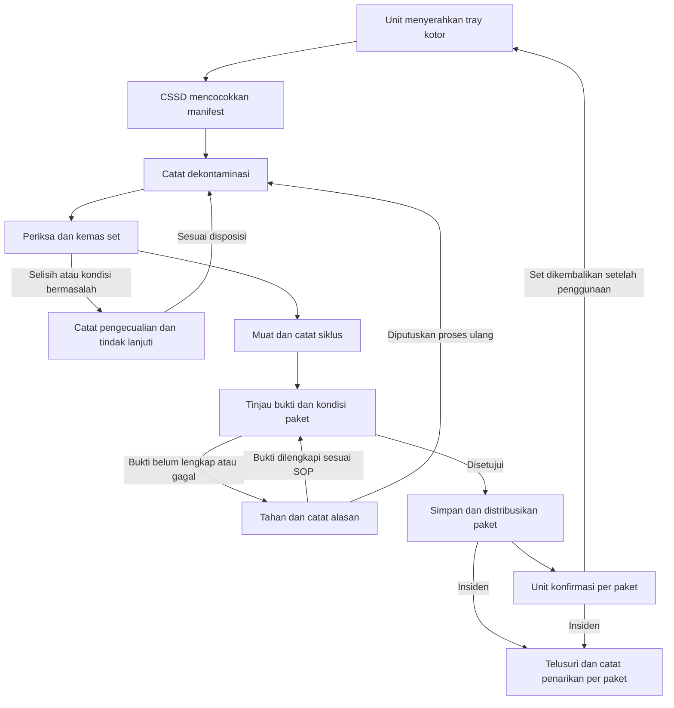

# SIMRS CSSD · Design dan alur penggunaan

**Status** Rancangan UI/UX target produksi. Alur, kewenangan, kondisi pelepasan, dan perangkat dikonfirmasi bersama rumah sakit sebelum implementasi dan go-live.

## Dasar desain

Layar awal mengikuti peran dan pekerjaan pada stasiun. Petugas membuka pekerjaan dari antrean atau memindai kode fisik. Sistem mengenali apakah kode menunjuk tray, paket, atau batch. Layar menampilkan identitas, lokasi, tahap, dan tindakan yang diizinkan. Setelah penyimpanan, tampilkan bukti tindakan singkat dan lanjutkan ke antrean stasiun dengan filter tetap aktif.

Rujukan operasionalnya adalah [Spesifikasi Produksi CSSD](https://chatgpt.com/library?file_id=libfile_f85dbee60c2481919a6cb722da907202&account_id=personal). [Studi perakitan Alfred dkk.](https://doi.org/10.1136/bmjqs-2019-010740) mendasari checklist per komponen, jumlah aktual, kondisi alat dan selisih. [CDC bagian 16, 18 dan 19](https://www.cdc.gov/infection-control/hcp/disinfection-sterilization/summary-recommendations.html) mendasari pemisahan siklus selesai, bukti pemantauan, integritas paket dan keputusan distribusi. [NHS HTM 01-01 Part A §6.17–6.19](https://www.england.nhs.uk/wp-content/uploads/2021/05/HTM0101PartA.pdf) menjadi rujukan penelusuran alat, siklus, petugas dan penggunaan. Profil pemantauan dan pelepasan mengikuti SOP serta instruksi pabrikan yang disahkan RS.

## Alur utama dan pengecualian

Tray fisik dapat dipakai kembali, paket mengidentifikasi satu hasil pengemasan, dan batch mengidentifikasi satu siklus. Jangan gabungkan jenis identitas ini di kolom Kode tanpa label jenis. Simpan riwayat lama ketika set diproses ulang. Tampilkan status proses, status mutu, dan posisi fisik sebagai informasi yang berbeda bila diperlukan untuk keputusan.

## Peta layar berdasarkan pekerjaan

| Layar awal / peran | Yang harus terlihat saat dibuka | Aksi utama dan hasilnya |
| --- | --- | --- |
| **Permintaan dan serah terima** · petugas unit | Permintaan unit sendiri, status pemenuhan, manifest retur dan paket yang perlu dikonfirmasi | **Buat permintaan**, **Serahkan tray kotor**, atau **Konfirmasi penerimaan** pada tugas terkait. Simpan diterima/ditolak per paket dengan waktu dan petugas. |
| **Penerimaan** · operator zona kotor | Daftar serah terima masuk. Setelah pindai, tampilkan unit asal, kode tray, manifest dan jumlah yang diharapkan. | **Catat penerimaan**. Jika ada selisih, pilih komponen, isi jumlah aktual, kondisi dan alasan. Tampilkan item yang masih menunggu rekonsiliasi. |
| **Dekontaminasi** · operator zona kotor | Antrean tray yang sudah diterima, status proses, pilihan pekerjaan dan bukti yang diwajibkan profil. | **Mulai proses** atau **Catat hasil**, sesuai status. Proses yang gagal tetap terlihat dan diarahkan ke penanganan pengecualian. |
| **Inspeksi dan pengemasan** · operator zona bersih | Checklist jumlah harapan/aktual, kondisi alat, versi isi set, dan foto referensi komponen saat perlu dikenali. | **Buat paket dan cetak label** setelah pemeriksaan. **Catat selisih** atau **Kembalikan untuk proses ulang** bila sesuai kondisi. Cetak ulang label mempertahankan kode paket. |
| **Siklus** · operator mesin | Mesin, profil, isi muatan, paket yang siap dimuat, hasil yang tersedia, dan masalah perangkat. | **Catat siklus** dan **Catat hasil pemantauan** pada konteks yang sesuai. Paket masuk antrean mutu ketika catatan siklus tersedia. |
| **Verifikasi mutu** · petugas berwenang | Identitas batch, paket, status dan alasan, bukti yang diperlukan, riwayat keputusan serta perubahan bukti. | **Tinjau bukti**, **Tahan paket**, atau **Setujui pelepasan** menurut bukti dan kewenangan. Hanya paket yang memenuhi syarat serta disetujui dapat muncul sebagai stok siap distribusi. |
| **Stok dan distribusi** · petugas gudang | Daftar permintaan dan paket tersedia, lokasi, kondisi kemasan, status terkini, dan unit tujuan. | **Siapkan paket** lalu **Catat pengiriman** dengan pemindaian dan verifikasi tujuan. Paket yang ditahan kembali hilang dari pilihan kirim. |
| **Pelacakan dan recall** · supervisor/PPI | Pencarian paket, tray, batch, mesin dan rentang siklus. Tampilkan lokasi terakhir, waktu, unit penerima dan status tiap paket. | **Tinjau paket terdampak** lalu **Konfirmasi cakupan penarikan** sesuai kebijakan RS. Lacak stok yang diblokir, paket kembali, paket sudah digunakan dan paket belum ditemukan. |
| **Perangkat, master dan laporan** · teknisi/admin/supervisor | Kondisi perangkat dan pemeliharaan, versi template dan profil, serta laporan dengan definisi dan periode. | Kelola sesuai kapabilitas. Perubahan profil menunjukkan versi dan tanggal efektif. Laporan dan ekspor mengikuti pembatasan akses. |

## Wireframe fungsional

### 1. Antrean stasiun

| Bagian | Spesifikasi |
| --- | --- |
| Header | Nama stasiun aktif, shift bila tersedia, **Pindai kode** dan input manual. Biarkan label aksi kedua mengikuti stasiun, misalnya **Catat penerimaan**. Tombol yang terlihat memiliki tujuan dan izin yang jelas. |
| Toolbar | Pencarian kode dan nama alat/set, unit, status, serta jumlah hasil. Tab mengikuti tugas nyata. Contoh di Mutu: **Siap ditinjau**, **Menunggu bukti**, **Ditahan**. Hanya tampilkan hitungan yang berasal dari hasil query. |
| Daftar | Kode dan nama, asal/lokasi, status berlabel, pekerjaan berikutnya dan umur antrean. Gunakan satu kontrol detail yang dapat diakses keyboard. Pilihan baris dan fokus keyboard punya penanda berbeda. |
| Ringkasan detail | Detail singkat menampilkan identitas, alasan tertahan dan satu langkah paling relevan. Jika tidak ada akses, tampilkan tindakan sesuai izin, misalnya melihat status. |
| Aset visual | Sisipkan foto tray dan kemasan biru pada strip identitas stasiun yang dangkal. Foto menempati sisi kanan dan tidak menjadi latar tabel. Pada layar kecil strip boleh menyusut. |

### 2. Pemeriksaan set

| Bagian | Spesifikasi |
| --- | --- |
| Identitas | Kode tray, nama set, versi checklist, unit asal. Tetap terlihat dekat checklist. |
| Checklist | Kolom Komponen, Harapan, Aktual dan Kondisi. Gunakan thumbnail referensi seperlunya untuk membedakan komponen serupa. Foto berasal dari katalog RS yang diverifikasi. |
| Pengecualian | Ringkasan item kurang/rusak dapat dibuka ke baris pertama yang bermasalah. Simpan kemajuan pemeriksaan dan tampilkan status penyimpanan. Keputusan selisih diproses sesuai kebijakan. |
| Aksi | **Simpan pemeriksaan** selama pengisian. Setelah syarat terpenuhi, tahapan label tersedia pada konteks paket. Kesalahan printer menawarkan **Cetak ulang label** untuk paket yang sama. |

### 3. Verifikasi batch

| Bagian | Spesifikasi |
| --- | --- |
| Identitas | Kode batch, mesin, profil efektif dan daftar paket. Jika muatan memiliki kondisi khusus, tampilkan kondisi dan rujukan kebijakannya pada tempat pengambilan keputusan. |
| Panel keputusan | Status dan alasan ditampilkan di atas. Contoh: **Menunggu hasil** dan **Hasil indikator biologis yang diwajibkan profil ini belum tercatat**. Tindakan yang ditawarkan untuk keadaan ini adalah **Buka bukti batch** atau **Catat hasil** sesuai hak akses. |
| Bukti | Daftar pemeriksaan dengan cakupan, hasil, sumber, waktu dan verifikasi. Bedakan **Menunggu**, **Memenuhi**, **Tidak memenuhi**, dan **Tidak diwajibkan**. Tampilkan isi paket terdampak dan histori. |
| Keputusan | Reviewer melihat ringkasan bukti dan paket terdampak sebelum mengonfirmasi. API memeriksa ulang izin, versi dan blok aktif. Jika status berubah, tampilkan perubahan serta **Muat ulang bukti**. |

### 4. Distribusi dan recall

| Bagian | Spesifikasi |
| --- | --- |
| Distribusi | Mulai dari permintaan/unit tujuan. Pindai, tampilkan identitas paket dan kondisi terakhir, perlihatkan daftar paket yang benar-benar ikut dikirim. Konfirmasi penerima berlangsung per paket. |
| Pelacakan | Pencarian satu kolom mengenali jenis kode. Hasil memisahkan lokasi kini, riwayat perpindahan, bukti batch dan status penarikan. Tampilan jejak tersedia sebagai tabel untuk keyboard dan pembaca layar. |
| Recall | Pisahkan kandidat dari cakupan yang sudah dikonfirmasi, lalu tampilkan tindak lanjut **Di stok**, **Sudah dikirim**, **Diterima**, **Sudah digunakan**, **Sudah ditarik**, atau **Belum ditemukan** dengan waktu dan penanggung jawab. Konfirmasi satu paket tidak menutup seluruh insiden. |

## Keadaan yang harus dirancang dan diuji

| Kondisi | Respons UI |
| --- | --- |
| Pindai gagal atau kode ganda | Tampilkan penyebab bila diketahui dan tawarkan input manual. Paket yang sudah tercatat menampilkan transaksi yang ada dengan identitas jelas. |
| Daftar kosong | Bedakan **Tidak ada pekerjaan di stasiun ini** dari **Tidak ada hasil untuk filter ini**. Tampilkan **Hapus filter** hanya bila ada filter aktif. |
| Sedang memuat atau pembaruan gagal | Tampilkan apa yang sedang dimuat. Jika data lama masih ditampilkan, beri waktu pembaruan terakhir dan pembatasan aksi yang relevan. |
| Jaringan putus saat menyimpan | Jangan menampilkan sukses tanpa konfirmasi. Jika hasil pengiriman belum diketahui, cek status transaksi sebelum mengizinkan percobaan ulang. Prosedur downtime mengikuti SOP RS. |
| Saat ditolak atau status berubah | Tunjukkan alasan di dekat aksi dan pertahankan input yang aman dipertahankan. Fokus menuju pesan atau field pertama yang perlu dikoreksi. |
| Tablet dan ponsel | Tablet memakai detail satu panel. Ponsel memakai daftar singkat dan rute detail, dengan navigasi kembali yang menyimpan filter. Kontrol utama memiliki sasaran sentuh 44 px. |

## Identitas visual dan aset

| Elemen | Keputusan desain |
| --- | --- |
| Palet | Latar silver kebiruan #F4F7FA, sidebar #E9EFF5, permukaan #FFFFFF, tinta #17283C, aksi #005BAB, pilihan #E3EFFB. Silver metalik berasal dari fotografi. |
| Status | Amber #FAEED6 dengan teks #744A00 untuk menunggu. Merah lembut #F7E6E9 dan #8B2938 untuk ditahan atau gagal, dengan label yang spesifik. Hijau #E6F2E8 dan #245538 untuk hasil memenuhi. |
| Tipografi | Instrument Sans bila tersedia, Segoe UI sebagai fallback. Judul 28/36, isi tabel 14/20, metadata 13/18. Gunakan angka tabular untuk waktu dan jumlah. |
| Banner identitas | Pakai foto tray dan bungkus biru di `apps/web/public/images/cssd/sterile-tray-banner.png`. Foto dekoratif dengan alt kosong. Batasi strip desktop sekitar 96–120 px agar antrean tetap terlihat. |
| Foto pendukung | Pengemasan memakai foto katalog sebagai bantuan mengenali alat. Pada keadaan kosong awal, gunakan ilustrasi tray kecil bila pesan masih jelas tanpanya. Aset tambahan ini masih usulan. |
| Penempatan | Verifikasi, distribusi, dan recall memakai ruang untuk bukti dan tindakan. Gunakan ikon berlabel, garis pembatas dan pola status konsisten. |

## Kriteria review

1. Petugas zona kotor dapat pindai tray, menemukan selisih dan mencatat penerimaan tanpa mencari formulir lewat menu tambahan.
2. Petugas pengemasan dapat menemukan komponen yang kurang dan melanjutkan kasus setelah tindak lanjut tanpa kehilangan hasil sebelumnya.
3. Reviewer menemukan alasan batch tertahan dan bukti yang harus ditinjau langsung pada detail. Akun tanpa hak pelepasan tidak dapat menjalankan mutasi tersebut.
4. Penarikan dapat ditelusuri ketika satu paket masih di rak dan paket lain sudah diterima unit. Kedua paket punya status tindak lanjut sendiri.
5. Uji keyboard, fokus terlihat, pesan yang dapat diumumkan, kontras, zoom 200%, layar kecil, dan scanner/printer aktual. Simulasikan timeout, konflik antarpengguna, dan cetak ulang.
6. Saat review Anti-Slop, setiap tombol harus menuju tugas atau tindakan yang dapat dijelaskan. Foto, ikon, dan aksen harus membantu orientasi, pengenalan alat, atau keterbacaan. Bukti pengujian UI baru dapat dicatat setelah ada implementasi.